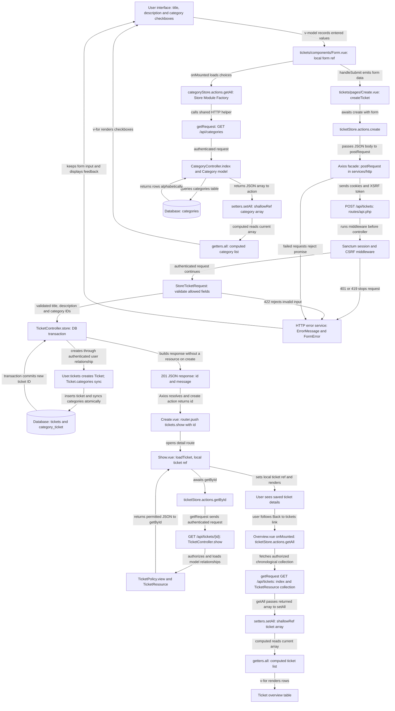

# Ticket Creation – Step-by-Step Explanation

## Overview

This document explains how I built the ticket creation process in my Client Support Portal. It covers how Vue sends the form data to Laravel, how the ticket is validated and saved, and how the result is displayed.

After creating a ticket, the user is redirected to its detail page. The ticket overview loads the updated list when the user returns to it.

## 1. Ticket Creation Flowchart (Requirement 27)

I created this flowchart to show how the different parts of my application work together during ticket creation. It includes the form, category loading, ticket store, Axios requests, Laravel validation, database operations, and the final result.

I also included how the Store Module Factory handles category and ticket collections using actions, getters, and state.



## 2. Frontend Form and Submission

I added the `/tickets/create` route in `resources/js/domains/tickets/routes.ts` with the name `tickets.create`.

The form is handled by `Form.vue`. I use Vue refs and `v-model` to store the title, description, and selected category IDs.

I load the available categories using `categoryStore.actions.getAll()`, which sends a GET request to `/api/categories`. Normal users can select categories but cannot manage them.

When the user submits the form, `handleSubmit()` passes the data to `Create.vue` without refreshing the page.

In `Create.vue`, I use `createTicket()` to call `ticketStore.actions.create(form)`. I also use a `busy` state to disable the submit button while saving.

If the ticket is created successfully, Vue redirects the user to `tickets.show` using the new ticket ID. If the request fails, the application displays an error and keeps the entered information.

## 3. Ticket Store and Axios

I added the ticket creation action in `resources/js/domains/tickets/store.ts`. It uses `postRequest` to send the form data to `/api/tickets` and returns the new ticket ID.

I use the shared Axios service in `resources/js/services/http/index.ts` to send JSON requests with Laravel's session cookie and CSRF token.

The frontend only sends the title, description, and category IDs. Laravel handles the ticket owner, status, and administrator assignment.

For errors, I use `ErrorMessage.vue` for general messages and `FormError.vue` for field validation errors.

My Store Module Factory manages ticket and category collections using `shallowRef`, a computed `getters.all`, and the `getAll()` and `setAll()` actions.

I kept ticket creation separate from the collection because Laravel only returns the new ticket ID and a success message, not a full list of tickets.

## 4. Laravel Authentication and Validation

I protected the ticket creation route in `routes/api.php` using `auth:sanctum`. The route calls `TicketController::store()`.

Only logged-in users can create tickets. Unauthenticated requests return a 401 error.

Before saving, `StoreTicketRequest` checks the submitted information:

- The title is required and can contain up to 255 characters.
- The description is required.
- Categories are optional, but selected IDs must be unique integers that exist in the database.
- Invalid information returns a 422 validation error.

I use `$request->validated()` so only allowed fields are used. Submitted values such as `user_id`, `status`, or `assigned_to` are ignored.

## 5. Saving the Ticket and Categories

In `TicketController::store()`, I separate the category IDs from the ticket data because they are stored in the `category_ticket` linking table.

I create the ticket through the logged-in user's relationship:

```php
$ticket = $request->user()->tickets()->create($data);
```

This automatically connects the ticket to the correct user.

I then save the selected categories using:

```php
$ticket->categories()->sync($categoryIds);
```

Both operations run inside `DB::transaction()`. If either operation fails, Laravel rolls back the changes.

After saving, Laravel returns HTTP 201 with the ticket ID and a success message.

## 6. Database Storage

The `tickets` table stores the ticket ID, user ID, title, description, status, assigned administrator, and timestamps.

When a ticket is created:

- The owner is the logged-in user.
- The status starts as Pending (`pending`).
- The assigned administrator is `NULL`.
- Selected categories are saved in `category_ticket`.
- Laravel adds the creation and update timestamps.

Foreign keys protect the relationships, and the linking table prevents duplicate ticket-category records.

No administrator response is created at this stage.

## 7. Displaying the Created Ticket

After Laravel saves the ticket, `Create.vue` receives its ID and opens the detail page.

`Show.vue` calls `ticketStore.actions.getById()`, which sends a GET request to `/api/tickets/{id}`.

Laravel uses `TicketPolicy::view` to check permission and `TicketResource` to return the allowed information. Internal notes are only included for administrators.

When the user returns to the overview, `ticketStore.actions.getAll()` loads the latest tickets and updates the table.

## Final Summary

I built the ticket creation process by connecting the Vue form, ticket store, Axios, Laravel controller, and database.

Users can create tickets with a title, description, and optional categories. Laravel checks authentication, validates the data, connects the ticket to the logged-in user, and saves it with a Pending status and no administrator assignment.

I also added error handling, database transactions, and permission checks to keep the process working correctly.

More setup and testing information is available in [SETUP_AND_TESTING.md](SETUP_AND_TESTING.md).
