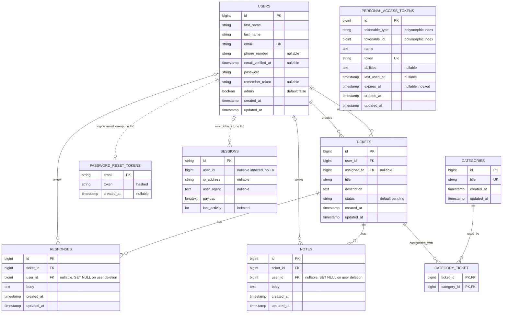

# Client Support Portal – Database Relationships

## Overview

I created this ERD to show how the database tables in my Client Support Portal are connected.

The diagram includes users, tickets, categories, responses, internal notes, and Laravel's authentication tables.

I used solid lines for relationships with database foreign keys and dotted lines for logical relationships without foreign keys.

The rendered version is available in [erd.svg](erd.svg).

## Database ERD

## Main Database Decisions

I used the following relationships and rules:

- **Users:** `admin = false` means a normal user, while `admin = true` means an administrator.
- **Tickets:** Every ticket has a creator (`user_id`). The `assigned_to` field can be NULL until an administrator is assigned. Status values are `pending`, `in_progress`, and `resolved`.
- **Categories:** Tickets and categories have a many-to-many relationship through `category_ticket`. Its combined primary key prevents duplicate links.
- **Responses and notes:** Both belong to tickets and have an author. Internal notes are private to administrators. Laravel checks this in the ticket controller and `TicketResource`.
- **Administrator permissions:** Only administrators can assign tickets, change their status, and create or edit responses. Laravel validation checks that an assigned user is an administrator.
- **Category deletion:** Categories linked to existing tickets cannot be deleted. Deleting a ticket also removes its connected category records, responses, and notes.
- **User deletion:** Administrators cannot delete themselves or users who own or are assigned unresolved tickets. If deletion is allowed, the user's resolved tickets and their related records are removed. Assignments on surviving tickets are cleared.
- **Preserved authors:** Responses and notes written by a deleted user on other tickets remain saved. Their `user_id` becomes NULL through `ON DELETE SET NULL`, and the application displays **Deleted user**.
- **Authentication records:** Password reset tokens use email without a foreign key, and sessions use an indexed `user_id` without a foreign key. I remove these records when their user is deleted. Password reset tokens are hashed.
- **Sanctum:** I kept the `personal_access_tokens` table, but the Vue application uses session cookies rather than bearer tokens.

Laravel also creates framework tables for cache, cache locks, jobs, job batches, and failed jobs. These are separate from the ticket workflow, and I did not add a queue worker.

I added a migration to make the response and note author IDs nullable with `ON DELETE SET NULL`. If the database structure changes later, the ERD should be checked against the latest migrations.
