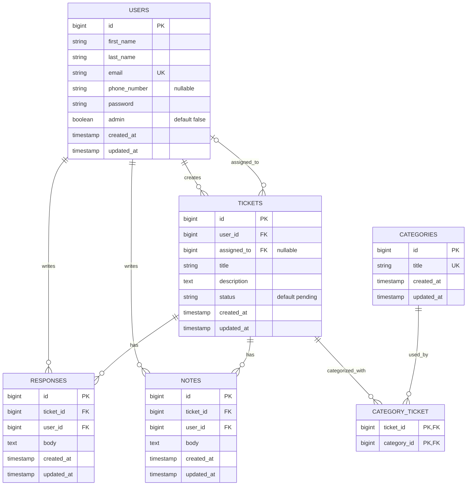

# Client Support Portal ERD

## Decisions

- `users.admin = false` means normal user.
- `users.admin = true` means administrator.
- `tickets.user_id` is the required creator.
- `tickets.assigned_to` is nullable because tickets may be unassigned.
- `tickets.status` uses `pending`, `in_progress`, or `resolved`.
- Tickets and categories have a many-to-many relationship through `category_ticket`.
- Responses and notes both belong to a ticket and an authoring user.
- Only administrators may later assign tickets, change status, create responses, and create/view notes. Those are backend business/authorization rules rather than foreign-key rules.
